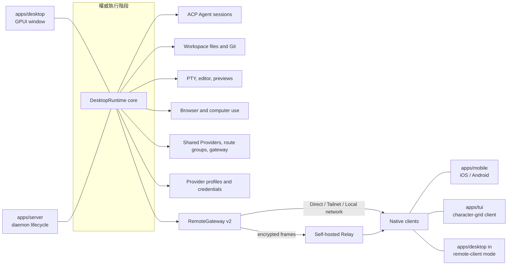

Vibex 通過"**權威執行階段 + 型別化投影**"讓多個原生客戶端保持一致。不要在客戶端、Relay 或 UI 層建立第二份權威業務狀態。

## 執行階段關係



關鍵點是**同一個 `DesktopRuntime` 核心有兩種前端**：`apps/desktop` 給它加一個 GPUI 視窗，`apps/server` 給它加一套守護程序生命週期。兩者暴露完全相同的 Remote v2 閘道器。

## 主要 crate 與 app

| 層 | 職責 |
| --- | --- |
| `crates/core` | 序列化 id、DTO、錯誤、能力和遠端協議契約。 |
| `crates/db` | SQLite 持久化、遷移與查詢。 |
| `crates/desktop-model` | 與框架無關的會話、時間線投影和 reducer。 |
| `crates/desktop-runtime` | 組裝權威執行階段：home 版面、通道身份、能力 facade。 |
| `crates/vibex-backend` | 原生與遠端介面卡共用的供應商無關能力 facade。 |
| `crates/vibex-ui` | 語義 token、可移植元件模型和工作流控制器。 |
| `crates/vibex-remote-client` | 配對、重連、同步和傳輸路由選擇。 |
| `crates/agent` | Agent 會話管理與本地歷史匯入。 |
| `crates/agent-acp` | ACP 介面卡、目錄與執行階段探測。 |
| `crates/agent-claude` / `crates/agent-codex` | 兩個內建 Agent 的專用適配。 |
| `crates/fs` / `crates/git` / `crates/terminal` / `crates/content` | 檔案、Git、PTY 與內容預覽服務。 |
| `crates/browser` / `crates/computer` | 內嵌瀏覽器與電腦操作：執行階段持有程序、權限、審計和工具面。 |
| `crates/model-gateway` / `crates/model-catalog` | 本地模型閘道器、路由策略、協議轉換與模型目錄。 |
| `crates/remote` / `crates/relay` | Remote v2 閘道器與 Relay 契約。 |
| `crates/config-switch` | 配置匯入匯出、原生配置改寫與金鑰儲存。 |
| `crates/backup` / `crates/diagnostics` | 備份恢復與脫敏診斷。 |
| `crates/app-update` | 簽名自動更新。 |
| `crates/vibex-terminal-ui` / `crates/vibex-tui` | 終端機模擬與 Vibex TUI 客戶端。 |
| `apps/desktop` | 原生工作台；內嵌執行階段。 |
| `apps/server` | 無頭權威執行階段 `vibex-server`。 |
| `apps/mobile` | 把共享遠端投影組合成 Android / iOS 原生介面。 |
| `apps/tui` | 字元網格客戶端，渲染同一套執行階段投影。 |
| `apps/relay-server` | 轉發不透明的加密 WebSocket 幀。 |

SSH / WSL 遠端執行階段由 `apps/desktop/src/ssh_connection` 配置和管理：桌面端通過 SSH 安裝 `vibex-server`、打開回環隧道並配對，然後把它當作 Remote v2 執行階段使用。詳見 [SSH Remote Runtime](https://github.com/vibex-ai/vibex/blob/main/docs/remote/ssh-runtime.md)。

## 資料流規則

事件帶有權威序號和版本。客戶端檢測到 generation 或 cursor gap 時**必須**返回 `resync_required`，然後從權威執行階段重新獲取。檔案寫入還要遵循內容修訂和 compare-and-swap（CAS）檢查。

遠端附件在建立流之前重新認證和授權。終端機輸入帶工作區作用域、generation 檢查和審計；不要儲存原始終端機位元組。

## 專案與工作區模型

```text
ProjectRecord   { id, name, root_path }
  └── WorkspaceRecord { id, project_id, root_path, mode }   mode ∈ { CurrentCheckout, VibexWorktree }
        └── Session
```

一個專案對應多個工作區。`VibexWorktree` 工作區不是"另一種模式"，而是同一專案下的另一個工作區。

## 持久化和恢復

SQLite 儲存專案、工作區、會話、時間線、供應商設定、共享 Provider、路由組、網關臺賬、終端機後設資料、瀏覽器配置、電腦操作審計和遠端裝置。

**只存在於記憶體、重啟即丟失：** Agent 程序、終端機會話內容、瀏覽器標籤與畫面、活動連線、正在進行的電腦操作會話。資料庫中的 `running` 只是上次觀察到的狀態，重啟後必須重新探測，丟失的終端機標記為 `stale`。

## 變更評審清單

- 是否仍由權威執行階段擁有唯一真相？
- 新能力是否同時支援本地與配對執行階段（經 `BackendFacade`），而不是隻走本地路徑？
- 是否使用共享 DTO、錯誤和能力，而不是複製結構？
- 是否為重連、序號間隙、撤銷和恢復定義行為？
- 是否脫敏日誌、診斷資料和測試證據？

## 延伸閱讀

- `docs/architecture/ui-boundary.md`
- `docs/remote/protocol-v2.md`
- `docs/platform/support-matrix.md`
- `docs/operations/recovery-matrix.md`
